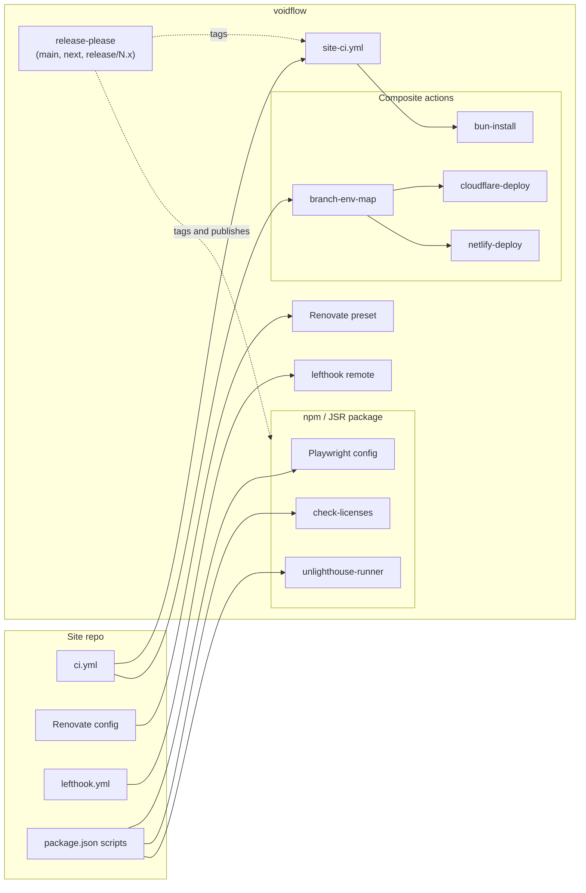

# voidflow

Shared CI, deploy and repo config for web sites and bun tools. It natively
supports deployments on Netlify and Cloudflare Workers, and is
framework-agnostic: any site that exposes the expected `package.json` scripts
works. bun is the default package manager; pnpm is supported. Playwright and
Astro defaults are opt-in extras.

4 sites use it, 253 tests cover it, and it has shipped 27 stable releases.



| Piece | What it does |
|---|---|
| [`site-ci.yml`](#site-ci) | Lint, typecheck, build, unit, license, Playwright, axe and Unlighthouse for sites |
| [`tool-ci.yml`](#tool-ci) | gitleaks, lint, typecheck, build, test, workflow audit for bun tools |
| [Deploy actions](#deploys) | Map branch to environment, deploy to Cloudflare or Netlify |
| [`unlighthouse-runner`, `check-licenses`](#npm-package) | Performance budgets and copyleft license check (npm bins) |
| [`@taraxvoid/voidflow/playwright`](#playwright-config) | Playwright config for `astro preview` |
| [`@taraxvoid/voidflow/biome`](#biome) | Shared Biome config |
| [`github>taraxvoid/voidflow`](#renovate) | Shared Renovate preset |
| [`lefthook/base.yml`](#git-hooks) | Shared git hooks |

## Pinning

Pin to a release commit SHA with the version in a comment, like any
third-party action. Renovate and Dependabot can bump it.

```yaml
uses: taraxvoid/voidflow/.github/workflows/site-ci.yml@<sha> # vX.Y.Z
```

`@v0` follows the newest stable 0.x release if you'd rather float. To try
unreleased changes, pin the SHA of a `vX.Y.Z-next.N` tag. Don't use `@main` or
`@next`. Release channels are described in [`RELEASING.md`](RELEASING.md).

## Site CI

```yaml
# .github/workflows/ci.yml
name: CI
on:
  push:
    branches: [main]
  pull_request:
    branches: [main]
    types: [opened, synchronize, reopened, ready_for_review]
  workflow_dispatch:

jobs:
  validate:
    uses: taraxvoid/voidflow/.github/workflows/site-ci.yml@<sha> # vX.Y.Z
```

`main` deploys to prod and pull requests get previews; there are no other
environment branches. The `push` trigger validates direct pushes to `main`.

It runs whichever of these `package.json` scripts the site defines (missing
ones are skipped with a notice):

| Script | When |
|---|---|
| `lint`, `check`, `build`, `test:unit` | always |
| `check:licenses` | lockfile or `scripts/` changed |
| `test:e2e:all`, `test:e2e:a11y`, `test:e2e:lighthouse` | e2e-relevant files changed |

Inputs:

| Input | Default | |
|---|---|---|
| `runner` | `ubuntu-latest` | Runner label |
| `package-manager` | `bun` | `bun`, `pnpm` or `aube` (see below) |
| `build` | `true` | Run `build` as its own step. Pass `false` when the e2e scripts already build |
| `build-env` | `{}` | JSON object of build env vars. Visible in logs, so no secrets |
| `code-paths` | everything except Markdown, `docs/`, `LICENSE*`, issue templates | JSON array of globs (`!` excludes) that count as code |
| `e2e-scripts` | `[]` | JSON array of extra e2e scripts (see below) |
| `e2e-extra-paths` | `["wrangler.jsonc", "site.vars.json"]` | JSON array of globs that also trigger e2e |
| `socket-scanner` | `false` | Run the bun install security scanner in CI (see below) |
| `playwright-install-with-deps` | `true` | Install Playwright system deps |

Pull requests outside `code-paths` skip install, lint and tests but still pass
`validate / Validate`. Pushes and manual runs always run everything.

### pnpm and aube

pnpm takes its version from `packageManager` and Node from `volta` or
`engines`. aube needs the site's `mise.toml` to pin it (`aube = "<version>"`),
then follows `packageManager` and takes Node from `devEngines.runtime`. Both
use `pnpm-lock.yaml`.

### Extra e2e scripts

Scripts listed in `e2e-scripts` run in order after the built-in ones whenever
e2e-relevant files changed. Unlike the built-in ones, a missing one fails the
job.

```yaml
    with:
      e2e-scripts: '["test:e2e", "test:e2e:gtm", "test:e2e:editor"]'
      build: false
```

### Socket install scanner

If `bunfig.toml` sets `install.security.scanner`, CI installs with that line
removed (everything else still applies) and leaves a notice, so a flaky
third-party API can't fail the build. Local installs still run it. Pass
`socket-scanner: true` to run it in CI too.

Write it as a plain `scanner = "..."` line or dotted `security.scanner`. An
inline table can't be removed cleanly, so the install fails instead.

Workflows that install outside `site-ci.yml` get the same behavior from the
composite action:

```yaml
- uses: oven-sh/setup-bun@<sha> # <version>
- uses: taraxvoid/voidflow/actions/bun-install@<sha> # vX.Y.Z
  # with: { socket-scanner: 'true' }
```

### Migrating from main/next/live

- Drop `single-environment` from `site-ci.yml` callers; GitHub rejects
  unknown inputs.
- `branch-env-map` takes no inputs and fails on `next`, `live` and pushes to
  other branches.
- `test:e2e:full` no longer runs; define `test:e2e:all` instead.

## Tool CI

For bun CLIs, TUIs and libraries. Runs gitleaks over full history, installs
(same scanner handling), installs tools from `mise.toml` if present, then
whichever of `lint`, `check`, `build` and `test` exist, plus `check:licenses`
when dependencies or `scripts/` change. When workflows change it also runs
jactionlint and [zizmor](https://github.com/zizmorcore/zizmor). Bun version
comes from `.bun-version` if present. Inputs: `runner`, `socket-scanner`.

```yaml
name: CI
on:
  pull_request:
    types: [opened, synchronize, reopened, ready_for_review]
  push:
    branches: [main]
  workflow_dispatch:

permissions:
  contents: read
  pull-requests: read

jobs:
  validate:
    uses: taraxvoid/voidflow/.github/workflows/tool-ci.yml@<sha> # vX.Y.Z
```

The required status check is `validate / Validate`.

## Code scanning (SARIF)

`site-ci.yml` and `tool-ci.yml` write gitleaks and zizmor results as SARIF
and keep them as the `voidflow-sarif` artifact (7 days). gitleaks still fails
the job on a finding; the zizmor SARIF run scans every workflow and never
fails the job (the zizmor gate in `tool-ci.yml` is unchanged). Both steps run
after a failure too, so the findings that failed a run are the ones uploaded.

`upload-sarif.yml` sends them to code scanning, which is what voidlight
counts. It is a separate workflow because it needs `security-events: write`,
and a reusable workflow can't ask for more than its caller grants: adding it to
the validate workflows would break every caller that doesn't. Add a second job:

```yaml
jobs:
  validate:
    uses: taraxvoid/voidflow/.github/workflows/site-ci.yml@<sha> # vX.Y.Z
  sarif:
    needs: validate
    if: ${{ !cancelled() && needs.validate.result != 'skipped' }}
    permissions:
      contents: read
      actions: read
      security-events: write
    uses: taraxvoid/voidflow/.github/workflows/upload-sarif.yml@<sha> # vX.Y.Z
```

Each tool uploads under its own category (`gitleaks`, `zizmor`), so a later
run closes only that tool's fixed alerts. gitleaks SARIF is redacted.
Code scanning is free on public repositories; private ones need GitHub Code
Security, without which the upload step fails.

## Deploys

`actions/branch-env-map` maps `main` to `prod` and pull requests to `preview`;
any other ref fails. Run it as the first step of the deploy job:

```yaml
jobs:
  deploy:
    name: Deploy
    needs: validate
    runs-on: ubuntu-latest
    steps:
      - uses: actions/checkout@<sha> # <version>
      - id: env
        uses: taraxvoid/voidflow/actions/branch-env-map@<sha> # vX.Y.Z
      - uses: taraxvoid/voidflow/actions/cloudflare-deploy@<sha> # vX.Y.Z
        with:
          env: ${{ steps.env.outputs.env }}
          cloudflare-api-token: ${{ secrets.CLOUDFLARE_API_TOKEN }}
```

A job's `name:` and `environment:` can't read its own step outputs. To use
GitHub deployment environments, add one deploy job for `main` and one for pull
requests, each gated with an `if:`.

- `actions/cloudflare-deploy`: `wrangler deploy --env <env>`, with an optional
  D1 migration first (`migrate-d1`). `preview` needs a matching env block in the
  wrangler config, or pass `command` to deploy previews another way. Other
  inputs: `cloudflare-account-id`, `working-directory`, and `token-fallback`
  (warns on every deploy while the repo's token uses the account-wide
  fallback, see [`CONTRIBUTING.md`](CONTRIBUTING.md)).
- `actions/netlify-deploy`: `prod` is a production deploy, anything else (e.g.
  `preview`) is an alias deploy. Inputs: `env`, `publish-dir`, `netlify-auth-token`,
  `netlify-site-id`, `working-directory`, `github-token`. Turn off Netlify's
  own GitHub auto-deploy for the site, or the two will double-deploy.

## npm package

```sh
bun add -d @taraxvoid/voidflow   # or: pnpm add -D @taraxvoid/voidflow
```

Also published unscoped as `voidflow` with identical contents.

Call the bins from `package.json` scripts rather than `bunx --package ...`, so
the version stays in the lockfile and the site's `bunfig.toml` applies. Both
bins need `bun` on `PATH`, even in npm or pnpm projects.

### Unlighthouse budgets

```json
"test:e2e:lighthouse": "bun run build && unlighthouse-runner --dir dist"
```

Serves the built directory and runs [Unlighthouse](https://unlighthouse.dev/)
with Playwright's Chromium. Fails if a category budget fails.

- `--dir`: default `dist`; use `dist/client` for the Cloudflare adapter
- `--config`: default `unlighthouse.config.ts`; start from
  [the example](scripts/unlighthouse/unlighthouse.config.example.ts)
- `--version`: Unlighthouse version

Add `.unlighthouse/` to `.gitignore`.

### License check

```json
"check:licenses": "check-licenses"
```

Fails on GPL, AGPL, SSPL and similar copyleft licenses. LGPL is allowed.

### Playwright config

For Astro sites that run e2e against `astro preview`. Requires
`@playwright/test`. Runs on Node 22+ without Bun.

```js
// playwright.config.js
import { definePreviewConfig } from '@taraxvoid/voidflow/playwright'

export default definePreviewConfig({ ciPort: 4141 })
```

Picks a free port locally and skips `webServer` when `PLAYWRIGHT_BASE_URL` is
set. Options: `ciPort` (required in CI), `runner` (default `bun`), `timeout`
(default 30000), `projects` (default Pixel 7 and Desktop Chrome), `testDir`
(default `./test/e2e`).

### Biome

Needs Biome 2. In the site's `biome.json`:

```json
{
  "$schema": "https://biomejs.dev/schemas/2.5.14/schema.json",
  "extends": ["@taraxvoid/voidflow/biome"],
  "files": {
    "includes": ["**", "!**/bun.lock", "!public/admin/**"]
  }
}
```

The base sets formatting (4-space indent, width 80, single quotes, semicolons
as needed), the `recommended` rules, and turns off unused-import/variable rules
in `.astro` files. HTML formatting uses `whitespaceSensitivity: "strict"`, so
the formatter never drops a space at the edge of an element's text (such as
`<a href="/x">docs </a>and`). It has no ignore lists. Lists like `files.includes` and
`overrides` merge with the base; single values in the site win.

## Renovate

```json
{
  "$schema": "https://docs.renovatebot.com/renovate-schema.json",
  "extends": ["github>taraxvoid/voidflow"]
}
```

Requires the Renovate GitHub App. Based on `config:best-practices`: 3-day
release age (except voidflow and security fixes), `chore(deps):` commits,
grouped updates, Monday mornings. It also bumps the lefthook remote `ref`, and
`justfile` tool versions annotated with
`# renovate: datasource=... depName=...` on the line above.

## Git hooks

Shared lefthook hooks for bun or pnpm repos. Each step runs the repo's own
`package.json` script and is skipped if the script is missing.

- `pre-commit`: dependency guard, `format` (re-staged), `lint:actions`,
  `check`, `test:unit`, and `check:licenses` / `audit` when the lockfile changed
- `commit-msg`: Conventional Commits hint (never blocks)
- `pre-push`: stop if the remote is ahead, then `test:push`

```yaml
# lefthook.yml
remotes:
  - git_url: https://github.com/taraxvoid/voidflow
    ref: vX.Y.Z # a tag, not a SHA
    configs:
      - lefthook/base.yml
```

Install the binaries with mise:

```toml
# mise.toml
[tools]
lefthook = "2.2.1"
gitleaks = "8.30.1"
jactionlint = "2.1.0"
```

and wire the hooks on install without failing where lefthook is absent (CI):

```json
"prepare": "lefthook install || echo 'lefthook not installed (run mise install); git hooks skipped'"
```

To run less locally, define `test:unit:precommit` or `check:precommit`;
pre-commit runs those instead. CI still runs the full scripts. For example:

- bun: `"test:unit:precommit": "bun test --changed"`
- pnpm workspace: `pnpm -r --filter '...[HEAD]' run <script>` (add
  `--filter '!{.}'` if the root defines the same script recursively)

Your `lefthook.yml` can add commands but not override shared ones. Don't set
`parallel: true` on `pre-commit`; it applies to the shared steps too and breaks
their ordering.

Upgrading from `lefthook/site.yml` (v0.13 and earlier): change `configs` to
`lefthook/base.yml`. The old file now fails commits with that instruction.

## Used by

[taraxvoid.net](https://taraxvoid.net), [Queer Omaha](https://queeromaha.net),
[Synth Omaha](https://synthomaha.net), [Soundry](https://soundryomaha.org).

Optional badge for your README (follows light/dark mode):

```html
<a href="https://github.com/taraxvoid/voidflow">
  <picture>
    <source media="(prefers-color-scheme: dark)" srcset="https://img.shields.io/badge/CI-voidflow-8b8fd9?labelColor=2b2d3a&style=flat">
    
  </picture>
</a>
```

## Contributing

See [`CONTRIBUTING.md`](CONTRIBUTING.md). MIT licensed.
