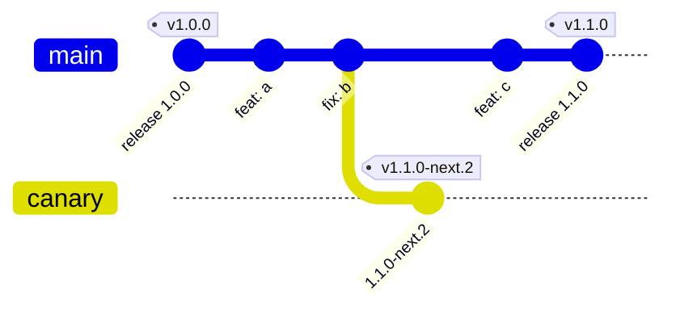

# Releasing

voidflow releases from one trunk, `main`, driven by
[release-please](https://github.com/googleapis/release-please) and Conventional
Commits ([`release-please.yml`](.github/workflows/release-please.yml)). Trusted publishing is configured on NPM using this repo name, the `release-please.yml` release job name, and the GitHub environment `npm`. That environment is the only server-side
limit on who can publish, so it deploys from `main`, `next` and `release/*`
only: the infra repo's rulesets config lists it under voidflow's
`environments`, and `rulesets-plan` reports drift.

| Source | Channel | Version | npm dist-tag | GitHub release |
|---|---|---|---|---|
| `main`, release PR merged | stable | `1.1.0` | `latest` | normal |
| `main`, `just canary` | canary | `1.1.0-next.2` | `next` | prerelease |
| `release/N.x` | maintenance (patch-only) | `0.9.4` | `release-N.x` | normal |



Which bump a change gets is set by [`STABILITY.md`](STABILITY.md): breaking
changes (`feat!:` or a `BREAKING CHANGE:` footer) go out only in a major, after
a deprecating minor.

| Situation | What you do |
|---|---|
| Ship a feature | PR to `main`, squash-merge. It joins the open release PR. |
| Try unreleased code | `just canary`. Publishes `X.Y.Z-next.N` under `next` after npm approval. |
| Release stable | Merge release-please's PR on `main`. After approving it on npm, `just sync-next X.Y.Z` moves `@next` to it. |
| Hotfix | PR to `main`, squash-merge, merge the release PR. |
| Backport | `release/N.x`, see below. |

**`main` stays releasable.** Work that is not ready to ship either stays on its
feature branch or lands behind a flag.

## Ship a feature

1. Branch from `main`, open the PR against `main`, squash-merge it.
2. release-please keeps a stable release PR open on `main`. Merging it tags
   `vX.Y.Z`, creates the GitHub release, publishes to npm under `latest` (and to
   JSR) and moves the floating `v1` tag.
3. Check the release PR's version before merging it. To pin it, set
   `"release-as": "X.Y.Z"` on the `.` package in `.release-please/main.json`
   with a squash-merged PR to `main`, and remove it in the first PR after that
   release, or every later release PR proposes the same version again. A
   `Release-As:` footer in a PR body isn't reliable: CodeRabbit appends its
   summary to the body, so the footer is no longer the last paragraph of the
   squash commit and isn't parsed.

## Canary

`just canary` runs the Release Please workflow on `main` with `canary` ticked
(run `just canary true` to only resolve the version). Canaries are on demand, never
per merge.

- The version is `<proposed>-next.<n>`: `<proposed>` is the version in
  release-please's open release PR on `main` (its title is
  `chore(main): release X.Y.Z`), `<n>` is the number of commits on `main` since
  the last stable tag. With no open release PR there is nothing releasable and
  `just canary` refuses.
- The workflow writes the canary version into `package.json`, `jsr.json` and the
  `VOIDFLOW` pin in `agentic/workflows/deps-review.md`, commits that on top of
  `main`'s tip (the commit never lands on `main`), pushes only the tag
  `vX.Y.Z-next.N`, creates a GitHub prerelease and publishes under `next`.
- Canarying the same commit twice gives the same version, and the rerun changes
  nothing: published versions are skipped, a staged one is a 409 notice, an
  existing tag and release are kept.
- A dry run resolves and prints the version but pushes no tag and publishes
  nothing.
- To try it in a site, pin the canary tag's commit SHA, or install with
  `bun add @taraxvoid/voidflow@next`. Each canary needs two npm approvals (see
  below).

## `@next` after a stable release

After `1.1.0` ships, `@next` would still point at the last canary, older than
`latest`. The release job cannot move it (a staged version only gets its tag at
staging, `npm stage approve` takes no extra tags, and CI's token does not get
dist-tag rights, which would also let it move `latest`). After approving both
packages on npm, run:

```sh
just sync-next 1.1.0
```

It checks that `1.1.0` is the current `latest` of both packages, then runs
`npm dist-tag add <pkg>@1.1.0 next` for each package where it sorts above the
current `next`. A canary for the following version moves `@next` forward again.

## Approve the npm release

npm packages are published with `npm stage publish`: the workflow uploads each
version to npm's staging area and it is not live until a human approves it
with 2FA. Each release stages two packages (`@taraxvoid/voidflow` and the
unscoped `voidflow` mirror), so approve both, `@taraxvoid/voidflow` first
(`voidflow init` run from the mirror writes a dependency on the scoped
package at the same version, which would not install until that is live),
via the Staged Packages tab on
npmjs.com or `npm stage approve <id>`. The GitHub release, `vX.Y.Z` tag and
floating `v1` tag are created before approval; actions consumers pin git tags,
so this is fine, but `npm install` of the new version works only after
approval. JSR publishes directly. CI cannot approve: approval and
`npm stage list` need a 2FA-capable npm session, not the workflow's OIDC token.
The publish job's summary lists each staged id with its `npm stage approve <id>`
command, so you don't need the npm email to find them.

Rerunning the publish job is safe: a version that is already published is
skipped, and one that is already staged makes the registry return a 409,
which the job reports as a notice. To restage a version (for example with a
different dist-tag), first reject it with `npm stage reject <id>`.

## Hotfix

PR to `main`, squash-merge, merge the release PR. It ships whatever is on `main`:
if `main` holds something unready, finish it, revert it, or cut a patch from the
last tag on a `release/N.x` branch.

## Backport to an older line

1. `just cut-maintenance v0.9.3 release/0.9.x` creates the branch in a new
   worktree. It copies the current release workflow, CI workflow, channel script
   and maintenance release-please config from `main` onto the old tag, because a
   branch cut from an older tag would otherwise run that tag's workflows. Push it:
   `git -C <worktree> push -u origin release/0.9.x`.
2. Cherry-pick the fix onto a branch from `release/0.9.x`, PR to
   `release/0.9.x`, squash-merge.
3. Merge the release PR that release-please opens there. It publishes
   `0.9.4` under the `release-0.9.x` dist-tag and never touches `latest` or `v1`.

## Republish a tag

Run the Release Please workflow manually (`workflow_dispatch`) from the branch
that owns the tag's channel (`main` or `release/N.x`), give it the tag, and tick
`dry-run` first to check without publishing. A tag is rejected unless its
version fits the channel (`main` takes `X.Y.Z` and canary `X.Y.Z-next.N` tags;
only `0.9.x` versions on `release/0.9.x`) and its commit is on that branch (for
a canary tag, its parent commit and only the version files changed).

## Consuming

See [Pinning](README.md#pinning) for pinning options.

### Verify an npm tarball

The publish job packs each npm tarball (`@taraxvoid/voidflow` and the
`voidflow` mirror), attests it with
[`actions/attest`](https://github.com/actions/attest), then publishes that same
file. The attestation is SLSA build provenance in GitHub's attestation store,
separate from npm's own `--provenance`, so `gh` can check a tarball from the
registry against this repo's release workflow:

```sh
npm pack @taraxvoid/voidflow@<version>
gh attestation verify taraxvoid-voidflow-<version>.tgz \
  --repo taraxvoid/voidflow \
  --signer-workflow taraxvoid/voidflow/.github/workflows/release-please.yml
```

`npm pack <spec>` downloads the registry's tarball as is. Releases before the
first one with this change have no attestation. A republish (`workflow_dispatch`)
attests only what it actually publishes, and a dry run attests nothing.
### Verify a release

Releases are published with GitHub's
[immutable releases](https://docs.github.com/en/code-security/supply-chain-security/understanding-your-software-supply-chain/immutable-releases)
setting on: a published release's tag and assets cannot be moved, changed or
deleted. GitHub records that with a signed release attestation for the tag,
commit and assets, listed on the repo's
[attestations page](https://github.com/taraxvoid/voidflow/attestations). The
setting is a repo toggle that can be turned off, so do not take this page's word
for it; ask GitHub:

```sh
gh release verify v<version> --repo taraxvoid/voidflow
gh release verify-asset v<version> <file> --repo taraxvoid/voidflow
```

`verify` passes only if the release exists and is immutable. A release also
shows the lock icon and "Immutable" label on its Releases page. `verify-asset`
checks a local file against an asset of the release; it cannot check the
auto-generated source zip or tarball.

What this does and does not tell you:

- The attestation is made when the release is published, so it is a point in
  time record. A release published while the setting was on stays immutable,
  and one published while it was off never gets an attestation, so a failing
  `gh release verify` leaves that release unverified: investigate the error
  before concluding it was mutable when published (it may be a transient or
  auth failure). Immutability applies to future releases only: v0.5.0 and earlier
  predate it and fail the check. `.github/immutable-since` names the first
  release that is covered (v0.5.1).
- The floating major tag (`v1` once 1.0.0 is out) is moved on every stable
  release on purpose and is not covered. To get the guarantee, pin the full
  `vX.Y.Z` tag or its commit SHA (see [Pinning](README.md#pinning)).
- The release workflow runs `gh release verify` on every release it creates and
  fails the run if it does not pass. A weekly workflow
  (`.github/workflows/verify-releases.yml`) re-checks every release since the
  baseline and opens an issue on a failure, so a release published without
  immutability does not go unnoticed (it detects the release, not a change to
  the repo setting). These are checks on our side; the attestation itself
  is what you verify.
- release-please creates the release with no uploaded assets, so there is no
  draft-then-attach step that immutability could break. The npm tarballs are
  separate and covered by the attestation above.
