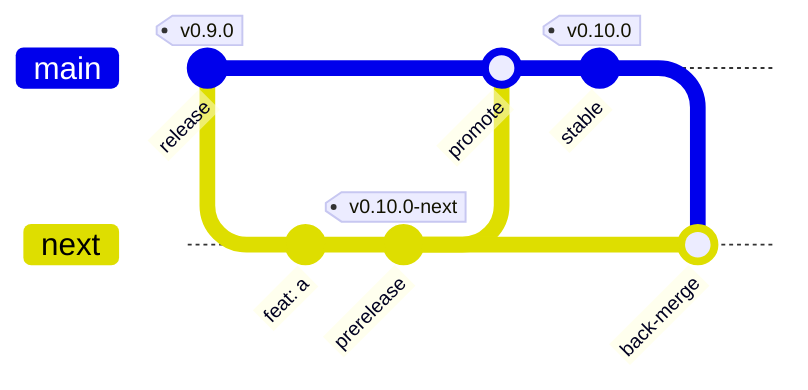

# Releasing

voidflow uses release channels mapped to branches, driven by
[release-please](https://github.com/googleapis/release-please) and Conventional
Commits ([`release-please.yml`](.github/workflows/release-please.yml)). Trusted publishing is configured on NPM using this repo name, the `release-please.yml` release job name, and the GitHub environment `npm`.

| Branch | Channel | Version | npm dist-tag | GitHub release |
|---|---|---|---|---|
| `main` | stable | `0.10.0` | `latest` | normal |
| `next` | prerelease | `0.10.0-next`, then `-next.1`, `-next.2` | `next` | prerelease |
| `release/N.x` | maintenance (patch-only) | `0.9.4` | `release-N.x` | normal |



Which bump a change gets is set by [`STABILITY.md`](STABILITY.md): breaking
changes (`feat!:` or a `BREAKING CHANGE:` footer) go out only in a major, after
a deprecating minor.

## Ship a feature

1. Branch from `next`, open the PR against `next`, squash-merge it.
2. release-please keeps a prerelease PR open on `next`. Merging it tags
   `vX.Y.Z-next` (then `-next.1`, `-next.2`), creates a GitHub prerelease and publishes to npm under
   `next` (and to JSR).
3. To try it in a site, pin the prerelease tag's commit SHA, or install the
   package with `bun add @taraxvoid/voidflow@next`.

## Promote next to main

1. `just promote` opens the `next` to `main` PR and sets it to auto-merge with a
   **merge commit** (not squash) so each Conventional Commit reaches
   release-please. The `main` ruleset allows squash and merge only. Don't promote
   from a hand-made branch: CI's promotion guard fails any PR into `main` that
   carries `next`'s commits unless its head is `next`. A squashed promotion
   gives `main` next's changes without next's commits, so every back-merge
   after it conflicts on the same lines.
2. release-please opens or updates the stable release PR on `main`. Merging it
   publishes under `latest`, moves the floating `v0` tag, and opens a
   `main` to `next` back-merge PR.
3. The back-merge PR auto-merges with a merge commit once checks pass. If you
   ever merge one by hand (e.g. after resolving conflicts), use a merge commit,
   never squash: a squash leaves main's commits out of next's history, so the
   following back-merge conflicts on the same lines again. If the back-merge
   job fails, it opens a "Back-merge of vX.Y.Z into next failed" issue; don't
   re-run the release run instead, it skips the job and goes green.

Check the stable release PR's version before merging it. release-please walks
`main` newest-first by commit date and stops at the last release commit, so a
`feat` on `next` dated before the latest stable release (e.g. a hotfix released
while the feature waited on `next`) is never counted and the PR proposes a
patch bump. Fix it with a squash-merged PR to `main` whose body ends with a
`Release-As: X.Y.Z` footer (the squash commit message is the PR body), then
add the missed entries to the release PR's `CHANGELOG.md` by hand.

## Approve the npm release

npm packages are published with `npm stage publish`: the workflow uploads each
version to npm's staging area and it is not live until a human approves it
with 2FA. Each release stages two packages (`@taraxvoid/voidflow` and the
unscoped `voidflow` mirror), so approve both, via the Staged Packages tab on
npmjs.com or `npm stage approve <id>`. The GitHub release, `vX.Y.Z` tag and
floating `v0` tag are created before approval; actions consumers pin git tags,
so this is fine, but `npm install` of the new version works only after
approval. JSR publishes directly.

Rerunning the publish job is safe: a version that is already published is
skipped, and one that is already staged makes the registry return a 409,
which the job reports as a notice. To restage a version (for example with a
different dist-tag), first reject it with `npm stage reject <id>`.

## Hotfix

Fix on a branch off `main`, PR to `main`, squash-merge, release as above. The
automatic back-merge brings it into `next`.

## Backport to an older line

1. `just cut-maintenance v0.9.3 release/0.9.x` creates the branch in a new
   worktree. It copies the current release workflow, CI workflow, channel script
   and maintenance release-please config from `main` onto the old tag, because a
   branch cut from an older tag would otherwise run that tag's workflows. Push it:
   `git -C <worktree> push -u origin release/0.9.x`.
2. Cherry-pick the fix onto a branch from `release/0.9.x`, PR to
   `release/0.9.x`, squash-merge.
3. Merge the release PR that release-please opens there. It publishes
   `0.9.4` under the `release-0.9.x` dist-tag and never touches `latest` or `v0`.

## Republish a tag

Run the Release Please workflow manually (`workflow_dispatch`) from the branch
that owns the tag's channel (`main`, `next` or `release/N.x`), give it the tag,
and tick `dry-run` first to check without publishing. A tag is rejected unless
its version fits the channel (`-next` versions only on `next`; only `0.9.x`
versions on `release/0.9.x`) and its commit is on that branch.

## If the back-merge fails

[`scripts/back-merge.ts`](scripts/back-merge.ts) resolves version bookkeeping on
its own: `package.json` and `jsr.json` get a real three-way merge with the version
lines normalised (so next-only changes survive), and `CHANGELOG.md` and the main
manifest take main's side. Any other conflict fails the job on purpose. Merge by hand:

```sh
git switch -c backmerge/fix origin/next
git merge origin/main     # resolve the conflicts yourself
```

Then set `.release-please/next-manifest.json` to the version main just released, but
only if that is newer than what is already there. After a hotfix on an older line
(main at `0.9.1`, next at `0.10.0-next.1`) leave it alone, or `next` would be pushed
backwards. Commit, push, open the PR against `next` and merge it with a merge commit.

## Consuming

See [Pinning](README.md#pinning) for pinning options.
